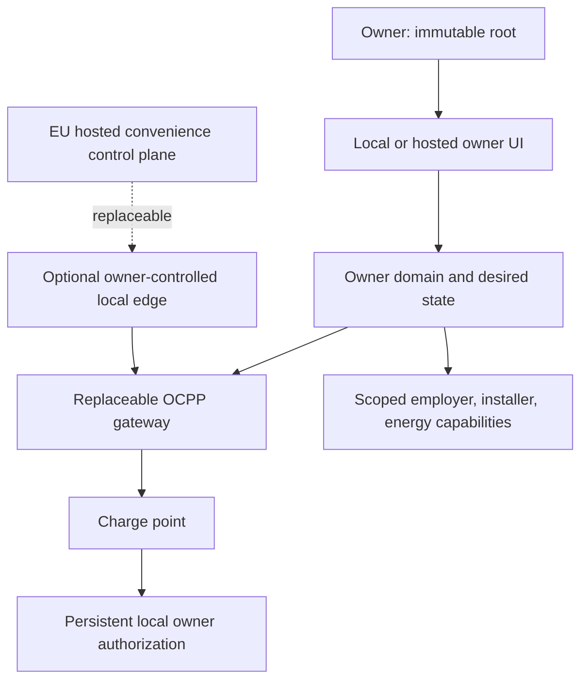

# Architecture

## One invariant, three availability layers

The charge point's local list keeps essential charging available. The local edge preserves local management. The hosted control plane adds remote access, fleet views, updates, and support. No upper layer may be required for an already-authorized owner to start a charge.

## Deployment modes

| Mode                | Charger endpoint             | Survives chargeOS cloud loss      | Survives local edge loss | Intended user             |
| ------------------- | ---------------------------- | --------------------------------- | ------------------------ | ------------------------- |
| Standalone fallback | None/vendor standalone       | Local RFID only                   | Not applicable           | Recovery and proof        |
| Local-first         | Owner edge on LAN            | Local management and charging     | Charger local RFID       | Sovereignty-focused owner |
| Hosted              | EU chargeOS gateway          | Local RFID, not remote management | Not applicable           | Convenience-first owner   |
| Hybrid              | Owner edge with cloud tunnel | Local management and charging     | Charger local RFID       | Default long-term design  |

Hosted mode must never be sold as equivalent to hybrid continuity.

## Components

### Charge point

The safety-critical EVSE remains vendor firmware. chargeOS configures only documented interfaces. A compatible device needs:

- owner-selectable OCPP JSON endpoint;
- persistent local authorization or an equivalent owner-only free-vend mode;
- recoverable local administration;
- buffered session/meter events with known limits;
- a documented rollback or standalone path.

### OCPP gateway

The TypeScript gateway in `server/gateway.ts` terminates OCPP 1.6J WebSockets, authenticates every explicitly provisioned station with its own secret, validates frames through `ocpp-rpc`, and maps protocol messages into stable evidence events. It rejects unknown station identities before handlers are registered and permits only one live socket per identity. Raw RFID values are HMAC-pseudonymized with that station's key before append. The pinned dependency historically names private schemas as malformed `urn:<method>` values; the checked-in narrow package patch maps only those validator identifiers to `urn:ocpp-rpc:<method>`, allowing advisory-fixed AJV/fast-uri while leaving wire method names and payload validation unchanged.

The MVP defaults to loopback plaintext for local development. The production Compose boundary puts chargeOS on an internal-only network and exposes separate OCPP and owner hostnames through Caddy-managed HTTPS/WSS. Unique station credentials and strict station allowlisting remain application controls. Caddy and Node share a bounded connection ceiling; the gateway accepts one socket per provisioned identity, caps complete WebSocket messages, token-buckets each peer's valid RPC calls, and closes malformed or dangling peers. Volumetric public-edge protection remains deployment-specific.

### Owner domain

Canonical records are independent of protocol version:

- owner, site, station, connector;
- credential pseudonym and authorization intent;
- desired and station-acknowledged authorization-list revisions;
- observed status, transaction, meter samples, and raw evidence hashes;
- model/firmware capability facts and test evidence;
- delegations, audit events, and continuity bundle versions.

The working edge implements the first delegate boundary. The owner issues a high-entropy bearer secret once; the ledger stores only its SHA-256 verifier, token hint, fixed role, explicit read scopes, creation time, and expiry. Installer, employer, and energy-provider role ceilings are canonical shared data rather than caller-selected strings. Grants expire within 90 days and append-only revocation wins immediately. Delegate APIs have dedicated data-minimized projections and no mutation routes; each successful read appends `DelegateCapabilityUsed` before returning. The owner token remains the only software root.

The owner-tag desired set has a separate custody boundary because the gateway needs raw OCPP identifiers while the evidence ledger must not retain them. The first configured station retains the backward-compatible `owner-tags.json`; additional stations use collision-resistant station-derived filenames under `owner-tags/`. Each closed-schema mode-`0600` file is independently HMAC-authenticated by that station's secret. Stale bootstrap input cannot overwrite durable state. Charger-scoped add and revoke operations rewrite only the selected station's complete state through a flushed atomic rename, retain at least one credential for that station, and append only the affected pseudonym, state version, count, and state authenticator to the station-scoped evidence chain.

The MVP uses a mode-`0600` append-only NDJSON ledger plus derived current state. Each append is flushed with `fsync` before success. Each stored record contains the previous record hash and its own SHA-256 hash; reads fail when an earlier record is edited, inserted, removed, or reordered. A station-keyed source-payload HMAC links redacted evidence to the received protocol payload without persisting raw RFID. Transaction ID allocation and its `StartTransaction` record are serialized and committed together before the charger receives a response; concurrent or post-recovery retries return the original ID. Authorization-list revisions are monotonic and always sent as a complete replacement after a fresh capability inspection. New results carry the exact list revision; projections pair legacy unversioned results only with the nearest unresolved command. Only an `Accepted` pair changes the derived acknowledged tag set, so a crash or rejection cannot silently advance local-access state.

The chain is tamper-evident, not independently signed: truncating the newest tail is detectable only against an owner-held checkpoint such as an authenticated continuity bundle. The edge verifies content-addressed, contiguous archive segments plus the active file as one cross-segment chain before binding, hard-caps the active file, checks each sealed append before write, and degrades health before maximum-message headroom is exhausted. It never silently truncates. A stopped-edge rollover first requires an encrypted bundle matching every event and segment boundary, atomically renames the active bytes into the next owner-only segment, and appends an `EvidenceSegmentArchived` record linked to the archived head. The active ceiling resets without changing or deleting historical evidence.

Finite-edge storage uses replacement rather than in-place deletion. A verified full continuity bundle remains separately held as the evidence authority. From that exact encrypted file, chargeOS can create a non-overwriting schema-4 compacted operational bundle whose custody record hashes the source bundle bytes and records its schema, chain head, event count, archive count, and export time. The new ledger rechains explicitly marked carry-forward records: every transaction start and replay identity, bounded transaction projection evidence, authorization/migration/Freedom/delegation state, latest connector state, and unknown future event kinds are retained; redundant meter retries, heartbeats, old connector state, archive audits, and older bounded use/rate audits stay only in the custodied source. A final `EvidenceHistoryCompacted` record binds the complete custody list and retention counts. The compacted ledger must fit the configured ceiling with one maximum-message append reserve, and it installs only into a fresh empty edge. Its redacted exports and recovery inspection remain labelled `compacted-operational`; carried records expose their source hash and are not represented as the original complete chain. Full historical review therefore requires every referenced source bundle. The software never deletes the source edge or bundle. NDJSON remains a single-owner, single-process edge boundary; a multi-tenant service still needs a transactional store, per-tenant isolation, retention policy, and external integrity anchors.

### Owner API and UI

`server/api.ts` exposes a small same-origin HTTP API and serves the compiled Preact UI. All owner state and commands require a separate 32-character-minimum bearer token. The health endpoint is intentionally non-sensitive. The API has no cookie authentication or permissive CORS, returns security headers, rate-limits failed authentication per source address, and emits only redacted continuity exports.

`GET /api/v1/fleet` is the aggregate owner view. It projects connection, current charging, recorded energy, owner-list synchronization, software readiness, migration attention, and evidence conflicts across the strict station registry without exposing credentials or raw RFID. Every detailed read, mutation, report, and delegate capability is addressable below `/api/v1/stations/:stationId/*`; the server resolves that station before projection or authorization and rejects unknown IDs. The UI opens on this fleet view when more than one station is provisioned and then drills into the complete charger console. Legacy unscoped routes remain aliases for the first station so an existing single-charger deployment upgrades without changing its workflow.

This is deliberately a **single-owner fleet**, not multi-tenancy. One immutable owner root controls all stations in the process. A hosted service for unrelated owners still requires account/session authentication, transactional tenant ownership, charger claiming and transfer ceremonies, tenant-key isolation, retention/deletion policy, and externally anchored audit state. Those are not implied by a fleet table.

The console has two presentation profiles over the same owner API. `personal` opens on monthly usage for one person's chargers. `company` serves an organization that is itself the owner of the chargers it runs for drivers: each station may carry an optional `driver` label, and the owner-only `GET /api/v1/usage` projection groups recorded sessions by month and driver for review and CSV export. Optional console modules (switching/Freedom Test, delegated access, evidence, AI troubleshooting) are a per-browser view preference. Hiding them removes no route, check, credential or evidence, and a module stays visible while a delegate grant is active or switching/Freedom Test work is open, stopped or stale. A driver label is not an account, grants no access and does not make the edge multi-tenant. An employee who owns their charger keeps their own owner root and shares sessions with the employer through the `employer` delegate role.

The dashboard never equates a connected socket with offline readiness. It can inspect charger-reported prerequisites and, after an exact owner confirmation, ask the gateway adapter to move only three explicitly writable settings toward the owner-continuity invariant. The typed API contract carries the request and result; the gateway owns the OCPP `ChangeConfiguration` mapping, performs a complete preflight before mutation, records every command/result, blocks on restart-required state, and re-inspects before reporting readiness. The owner may add a raw tag over the authenticated local/TLS API or revoke a displayed pseudonym with an exact stale-access confirmation. Those operations update desired state only and never trigger a charger command. The owner separately synchronizes the complete desired list only after every required check passes. Desired tag pseudonyms, the last acknowledged full list, unacknowledged command revision, pending additions, and pending revocations are separate owner-facing state. A pending revocation explicitly warns that stale charger-local access may remain available. Neither the UI nor public domain model receives engine-specific payloads, and the preparation path cannot change the endpoint, firmware, electrical settings, tag list, or restart the station. The dashboard also shows sessions and evidence and exports a redacted continuity record. A transaction start carries its authorization decision into evidence. Exact protocol retries remain in the ledger but collapse into one projected session; the first stop wins and any different later stop marks an evidence conflict rather than changing energy silently.

The migration dossier is a separate append-only state machine. Owner-recorded prerequisites retain only confirmed/blocked outcome, observation time, and a SHA-256 reference to evidence held elsewhere. Exact pre-switch identity records label/hardware fields plus expected OCPP vendor, model, and firmware from supported local/current-backend evidence and its external digest; it does not require the endpoint to have already changed. The pre-switch fingerprint covers every prerequisite record and this stable inventory. A separate canonical migration-target artifact binds exact identity, endpoint, OCPP 1.6J, transport validation, unique Basic credential custody, supported configuration path, backup/export evidence, rollback, restore drill, and immutable safety assertions without containing credentials. Its CLI can hash the exact owner-held files directly through a non-symlinked, stable-file boundary or accept an already-custodied digest, never both. Neither file contents nor paths enter the artifact. Strict parsing rejects unknown fields; canonical semantic bytes produce the hash, and non-overwriting create plus expected-hash verification bracket the field operation. During authorization the API parses the supplied file in memory, matches station/inventory/configuration path and each relevant evidence digest against the dossier, checks the selected transport and creation time, then persists only its hash with the prerequisite fingerprint and 15-minute-to-24-hour window. Any prerequisite or target change invalidates the relevant authorization evidence. Post-switch Boot evidence must arrive after authorization and inside the window and match the inventory exactly; status, capability inspection, owner-list acknowledgement, and positive-energy session evidence must follow that Boot. Even a complete online path remains unreviewed and does not replace the Freedom Test.

The Freedom Test panel has a separate evidence state machine. Protocol-derived steps use specific ledger events after the matching authorized Boot. Once every automatic online check passes, an explicit owner-confirmed schema-3 field run binds a random run ID to the exact device-inventory, migration-authorization, and authorized-Boot event IDs and chain hashes. Physical steps accept only that active run ID, pass/fail, observation time, and the SHA-256 digest of evidence held outside chargeOS; it does not upload potentially sensitive home/video artifacts. A changed inventory or migration baseline makes the prior run stale instead of carrying its physical outcomes forward. Exact article number, hardware revision, firmware, configuration path, connectivity, country, and prior operator remain bound to the record. Completing every step yields `evidence-complete-unreviewed`, never an automatic grade or certification.

The schema-1 Genesis plan is a deterministic projection over those migration and Freedom Test state machines. It gives the UI, owner API, and agents the same ordered `nextActions`, actor, execution boundary, evidence class, and safety class. It lists parallel pre-switch evidence obligations, permits endpoint work only during an active authorization window, returns one sequential online or witnessed step at a time, stops on failed or stale evidence, and ends at independent review rather than a liberation claim. It has no mutation path and cannot operate ACE, change an endpoint, restart a charge point, touch a SIM, or infer physical success.

### Local edge

The current edge is a version-pinned Node container with a local UI and persistent evidence volume. It boots without cloud identity and exposes health locally. Production Compose injects secrets as read-only files, keeps application ports internal, and terminates HTTPS/WSS at a replaceable Caddy boundary. CI validates both configurations and smoke-tests the non-root runtime. Stable tags build a commit-only registry candidate, rerun that complete production drill by immutable digest, attach GitHub/Sigstore build provenance plus a CycloneDX SBOM, and create the public version tag only after those gates. Owners deploy the digest rather than treating a mutable registry name as authority. This supply-chain evidence does not attest charger behavior or field configuration. The edge produces two deliberately different owner artifacts:

- a redacted JSON export for support and evidence sharing;
- an AES-256-GCM owner continuity bundle containing the verified ledger and recovery configuration, with a scrypt-derived key from a separately held passphrase.

Continuity payload schema 3 captures the current raw desired owner tags inside authenticated encryption, the explicit OCPP connection, payload, valid-call, burst, and evidence-capacity limits, and every archive segment's sequence, event count, boundary hashes, and canonical byte digest. Schema 4 carries the same recovery material and a verified compacted operational ledger plus its off-edge custody list; it does not contain the omitted original records. Export reads the canonical owner-tag state rather than the potentially stale first-boot seed. Restore refuses an existing target, authenticates and verifies the bundle, recreates exact segment boundaries, writes secrets/evidence with bounded permissions, and boots transaction replay on a replacement edge with those limits intact. Production restore is a distinct custody path: it requires fresh DNS/ACME metadata, creates an owner-private package with Compose file secrets and a verified read-only segmented-ledger transfer, then uses the compiled non-root CLI to install that chain into an empty persistent data mount. Installation is create-only, flushed, verified after write, and removes its own partial output on failure; it never merges with or replaces an existing ledger. Forwarded-address trust is topology authority rather than portable configuration: every restore records it as unvalidated, so a competent operator must revalidate the new single-proxy boundary before production Compose enables it. Schema-1 payloads remain recoverable using documented defaults and schema-2 payloads retain their safety limits; both restore as one active segment because they predate archive metadata. Passphrase rotation rewraps the exact verified snapshot with fresh encryption material into a non-overwriting bundle without writing plaintext recovery state. An optional owner-held Ed25519 key signs a compact public receipt over the snapshot identity and chain head; verification can be independent of the bundle secret, while bundle comparison proves an exact match. The signature is not an external timestamp or real-world identity proof. Cloud synchronization remains optional and must eventually be conflict-safe.

### Hosted control plane

The current fleet process is appropriate for one owner and up to 1,000 statically provisioned stations, subject to measured host and evidence capacity. A commercial multi-owner control plane should run long-lived OCPP WebSockets on ordinary EU-hosted containers/VMs with PostgreSQL and keep tenant ownership in transactional rows rather than stretching the NDJSON edge store. Cloudflare may front the web application/API, but a proprietary edge primitive is not the canonical OCPP or data layer because self-host parity is a product requirement. Add a queue or time-series system only when measured load requires it.

The commercial account foundation runs separately in `service/`, with a locally configured Cloudflare Worker/Drizzle D1 adapter and a native Node/SQLite adapter for the same handlers and checked-in schema. The native adapter executes atomic batches synchronously on one connection, binds migration history to source hashes, and exposes only a loopback HTTP bridge. All existing account and financial integration tests run against both databases; a compiled-process drill checks clean restart and persistent sessions. These adapter checks alone do not establish production readiness; the separate HTTPS pilot and reviewed owned-Docker public handoff have their own synthetic deployment/recovery proofs and still require live acceptance. Both runtimes default to operator-only local delivery; the native adapter also supports explicit SMTP dispatch for new local-trial links. Both remain separate from the owner deployment image.

Native commercial recovery has a separate authenticated envelope and no owner-edge credentials. The backup API produces a consistent copy; exact schema/migration and financial snapshot/journal checks validate that finished copy before encryption. Restore creates only a new private package, clears every old account/session/authenticator/recovery credential and records quarantine inside SQLite. Normal startup and outbox access refuse it before serving any route, even if the database is moved. Source provenance and financial digests describe an unreconciled snapshot, not current membership or financial authority. [Native commercial recovery](commercial-service.md#encrypted-native-backup-and-quarantined-restore) documents its limits. Reconciliation, fresh enrollment and a reviewed release workflow remain required for operational recovery.

The reopening preparation tool adds consistent original-source financial checkpoints and a restore-bound current review. It hashes immutable identities and all business records while allowing only a future authentication-enrollment delta. It requires every organization's matching financial checkpoint, explicit current membership and per-assignment eligibility decisions, and digests of operator-reviewed identity, roster, financial and source-retirement evidence. Protected administrator succession and conflicting immutable ends block this flow. An exclusive lifecycle directory serializes recovery operations. Its private `reviewed-not-enrolled` artifact changes no authority and does not release quarantine; fresh enrollment and final cutover remain required.

Fresh local enrollment now consumes that same current review under long-lived lifecycle custody. An authenticated private progress file binds one-use token verifiers, enrollment epoch and newly verified password/TOTP fingerprints to kept identities. A dedicated loopback listener exposes only setup/sign-in/TOTP/status/sign-out routes with separate recovery cookies, strict origin/body/peer limits and no business or charger handler. It re-evaluates current review bindings before actions and drains all asynchronous handler promises before releasing custody, including disconnected clients. Individual reissue resets only that person's credentials/proof; a changed reviewed epoch clears every old credential. `/service/recovery` keeps setup material transient and distinguishes credential readiness from reopening. Ordinary startup still refuses quarantine; the separate local release workflow below now performs final cutover.

The local release finalizer rechecks current external-review bindings and real fresh credential proofs under lifecycle custody. It validates the complete deterministic transformation on a private SQLite copy, then atomically applies roster/eligibility changes, clears sessions and publishes a same-epoch authenticated release receipt with in-transaction state and row-count guards. Explicit recovery attribution preserves human audits. Ordinary startup validates the active receipt and retained prior history without rejecting later legitimate business changes. Every subsequent restore removes active authority, rotates credentials and creates fresh quarantine while retaining historical attribution. This is local synthetic recovery, not production hosting or external-truth proof.

The native commercial runtime now has a separate optional SMTP queue worker for local-trial account links. Explicit activation stamps only newly created verification/reset/invitation records; existing/local records stay operator-only. Durable opaque leases and bounded retry run outside network-spanning transactions. Verified TLS, fixed templates and strict link/recipient checks constrain dispatch. SMTP acceptance deletes payloads but does not prove inbox delivery or exactly-once behavior. The worker holds recovery custody until physical socket closure and durable acknowledgement, and quarantined restores cannot send. Provider credentials and activation are separate from backups and owner-edge credentials. A separate [native company HTTPS Docker pilot](company-hosting.md) uses a sole loopback proxy, Secure cookies, exact signup domains and bounded mail admission. The managed company adapter uses a fresh standalone Coolify destination and pinned Raw Compose; only the platform proxy and company Caddy join that ingress network, while account/mail processes retain the loopback namespace. The [reviewed public handoff](public-company-recovery.md) fences the stopped local recovery and installs a distinct exact-origin public receipt in a fresh owned-Docker volume. It preserves reviewed fresh credentials, requires separately supplied SMTP and restores every later backup into a new quarantine with active public authority removed. Worker production hosting, live managed-platform/customer acceptance and managed-cloud recovery remain gated.

The service stores accounts, sessions, MFA, organizations, invitations, dated commercial assignments, policy versions, frozen reimbursement snapshots, duplicate-session reservations and organization audit. Approved corrections append hash-linked receipts and a linear replacement chain; session reservations stay with the original financial root and current balances must agree with the projected journal. [Correction details](reimbursement-corrections.md) describe the atomic gate and consistent read model. Financial approval is a separate-reviewer, current-TOTP, exact-snapshot transaction; it never changes the owner ledger or represents payment. See [Reimbursement statements](reimbursement-statements.md). `/service/api` cookies do not authenticate the owner API, and organization membership grants no station ownership or OCPP capability. [ADR 0003](decisions/0003-separate-commercial-worker.md) explicitly permits these commercial-only adapters without replacing owner-edge canonical state; [the service guide](commercial-service.md) records local delivery, public-deployment and tested portability gaps. The ordinary EU OCPP runtime recommendation above remains unchanged.

### Energy, home, and reimbursement adapters

Home Assistant, inverters, batteries, meters, and tariff providers connect through scoped adapters/webhooks. They contribute site observations and proposed schedules; the owner sets maximum current, availability, and override policy. The adapter cannot change station ownership, credentials, firmware, or local owner authorization. Employer reimbursement consumes a signed, scoped session export with meter provenance and never receives household-wide energy data.

## Local observation boundary

The browser-only `/observe` workspace uses typed contracts re-exported by `shared/contracts.ts` and the deterministic `shared/observation-engine.ts` module. It reads an explicitly selected CSV into memory, fingerprints original bytes, applies declared employee/station/policy inputs and exports an unapproved draft. It does not call the owner API, authenticate a customer, append imported data to the charger evidence ledger, change station configuration or move money. The product preview at `/preview` is separately lazy-loaded and fictional. See [Local observation](local-observation.md) for source provenance, decimal/unit/date requirements and financial limitations.

## Desired/observed synchronization

The Genesis edge seeds a durable owner-tag registry from owner-custodied configuration on first boot and then manages that desired set through owner-only full-state mutations. Each attempted station write receives a monotonic command revision; the station record separately retains only accepted acknowledgements. Differential charger updates remain deliberately unimplemented.

1. After adding or revoking a desired tag, treat the change as pending until a fresh inspection and complete-list acknowledgement. Never auto-synchronize as a side effect of credential management.
2. Always send a complete list because the current baseline may be unknown after reconnect, restart, or replacement-edge recovery.
3. Pair a result to the exact command revision. Never report a tag as active or revoked on the station before an `Accepted` acknowledgement.
4. While offline, show pending additions and revocations plus the risk that removed tags retain stale access.
5. On reconnection, inspect and reconcile before applying unrelated future remote commands.

## Agent and tool interfaces

The same typed operations should serve UI, CLI, and future agent tools:

- `get_owner_fleet`
- `get_genesis_plan`
- `inspect_station_evidence`
- `plan_migration`
- `manage_owner_authorization`
- `push_owner_authorization`
- `run_freedom_test`
- `export_continuity_bundle`
- `grant_delegation`

Tools must return evidence and uncertainty, not merely a success boolean. Dangerous actions—endpoint change, disabling local authorization, firmware update, ownership transfer—require explicit owner confirmation and an audit record.

## Later protocol layers

- OCPP 2.0.1: second transport adapter after Genesis; use its stronger device/security model where implemented.
- ISO 15118: charger-to-vehicle contract and Plug & Charge; it does not replace owner/CSMS portability.
- OCPI: operator-to-operator roaming/data exchange; irrelevant to first private-home continuity.
- OCPP 2.1 and ISO 15118-20: bidirectional/DER opportunities after charger and regulatory readiness.

The separate company image contains only the compiled native service and shared UI, with no owner server or charger credentials. Account and mail services share the non-root proxy network namespace so the sole loopback listener cannot be reached by other Docker peers. Public-origin recovery metadata grants no hosting authority; every restore remains fresh local quarantine. See [company hosting](company-hosting.md) for exact topology and remaining release gates.
